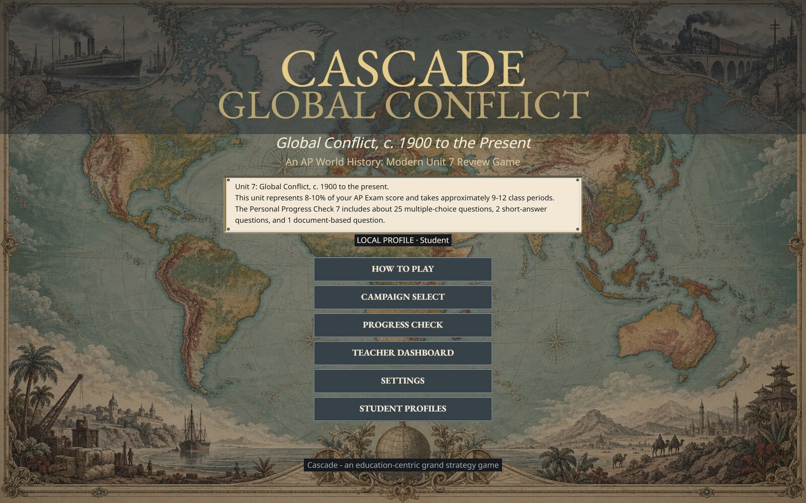
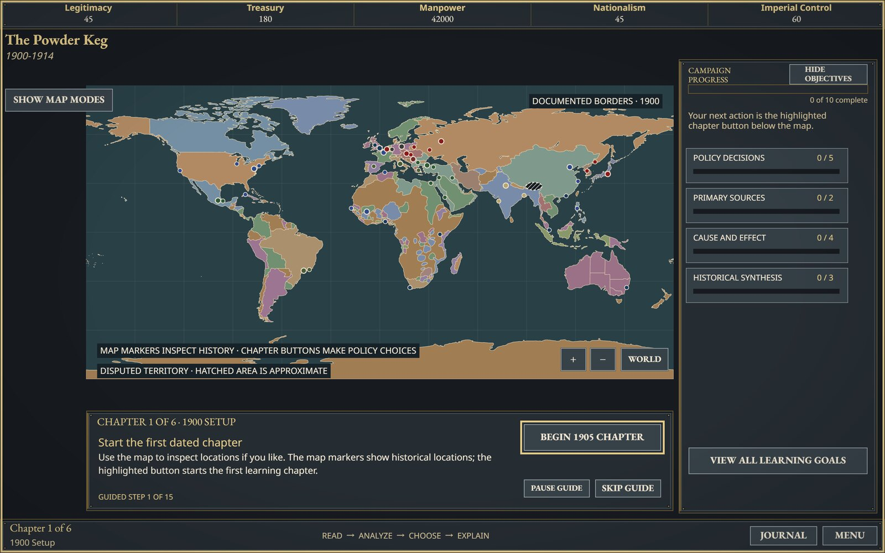

# Cascade

**Cascade is a browser-based AP World History: Modern Unit 7 game about global conflict from 1900 to the present.** It pairs a historical strategy map with primary-source analysis, policy decisions, and evidence-based writing.



## A clear first session

Start at the main menu, choose **Start a Campaign**, then select **The Powder Keg**. Its guided first scenario takes about 25–30 minutes. The walkthrough points to the next useful action and can be paused, skipped, or replayed.

The learning loop is simple:

1. Read the historical context and inspect the map.
2. Analyze a primary source or compare historical causes.
3. Make a policy choice and review its consequences.
4. Explain the change with evidence.



## What you can do

- Play ten connected scenarios covering AP World History Unit 7 topics and learning objectives.
- Explore historical SVG map snapshots from 1900 through 2010. Map markers identify scenario locations; historical borders are approximate and documented.
- Analyze primary sources, make strategic choices, trace causes, and write short historical arguments.
- Continue a campaign with named student profiles and saves stored in the current browser.
- Review topic and skill progress in the student journal and teacher dashboard.
- Use keyboard controls, adjustable text size, visible focus, and reduced-motion settings.
- Hear an original MIDI score and play over an original illustrated atlas.

The campaign teaches through strategy decisions; it does not reward casualties or treat simulated outcomes as documented history. The first scenario labels player choices and their game effects as alternate-history practice.

## Controls

- Click the highlighted chapter action to continue the guided scenario.
- Click map markers to inspect historical locations. Drag the map to pan; use the wheel or the plus and minus buttons to zoom.
- Scroll over reading panels and objective lists to see more. Page Up and Page Down also move long panels.
- Press Tab to move through controls, then Enter or Space to activate one. Use the arrow keys to inspect map locations and Enter to open the selected location.

## Run locally

Install Node.js and pnpm, then start the development server from a local checkout:

```powershell
pnpm install
pnpm dev
```

Open the local URL printed by Vite. To create and serve a production build:

```powershell
pnpm build
pnpm preview
```

## Verify changes

```powershell
pnpm run typecheck
pnpm run selfcheck
pnpm run assets:verify
pnpm run build
```

The browser flow can be checked with `pnpm run verify:visual`. It uses a local Edge or Chrome executable; set `CASCADE_BROWSER_EXECUTABLE_PATH` to its full path if the browser is not in the default Edge location. The check captures the main menu, campaign selector, briefing, and guided scenario, and reports browser console errors.

## Project structure

| Path                    | Responsibility                                                     |
| ----------------------- | ------------------------------------------------------------------ |
| `src/core/`             | Game session, turns, accessibility preferences, and save state     |
| `src/domain/scenarios/` | Historical scenarios, decisions, events, and game systems          |
| `src/data/`             | Curriculum crosswalk, sources, world geography, and question bank  |
| `src/scenes/`           | Menu, campaign, play, assessment, journal, and teacher screens     |
| `src/ui/`               | Reusable map, panel, analysis, and learning components             |
| `public/assets/`        | Historical maps, original artwork, MIDI tracks, and asset manifest |
| `docs/`                 | Curriculum coverage and third-party credits                        |

## Curriculum and credits

The [Unit 7 coverage guide](docs/unit-7-coverage.md) describes the learning-objective crosswalk and formative assessment limits. [Credits and licenses](docs/credits-and-licenses.md) identify the historical map data, original generated artwork, fonts, software libraries, and curriculum references. The historical map data is adapted from Historical Basemaps and carries its documented GPL-3.0 terms.

AP® is a trademark registered by the College Board, which is not affiliated with, and does not endorse, this project.

## Contributing

See [CONTRIBUTING.md](CONTRIBUTING.md) for local setup, project conventions, and the checks to run before opening a pull request. GitHub issue forms are available for bug reports and feature ideas.

## Community and project policies

- [Code of conduct](CODE_OF_CONDUCT.md)
- [Security policy](SECURITY.md)
- [Support guide](SUPPORT.md)
- [Governance](GOVERNANCE.md)
- [Changelog](CHANGELOG.md)
- [Development architecture](docs/architecture.md)
- [Third-party credits and licenses](docs/credits-and-licenses.md)

## License

Cascade's application code is currently marked `UNLICENSED` in `package.json`; this repository does not yet grant a general license to reuse that code. Third-party materials retain their own license terms, listed in the credits and alongside the relevant assets.
